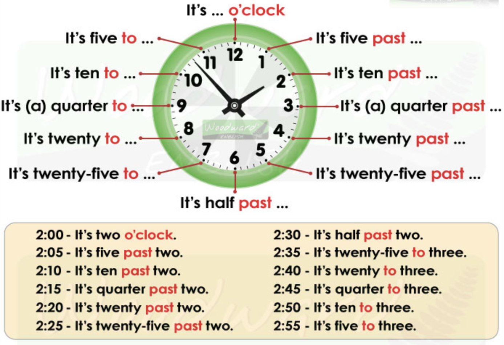

---

[Vissza](../angol.md)

---

## adjectives
$$
\begin{array}{|l|}
\hline
\text{It's a}\textbf{ big}\text{ house.} \\
\text{They're}\textbf{ pretty}\text{ flowers.} \\
\hline
\end{array}
$$

## telling the time

---

[Vissza](../angol.md)

---
