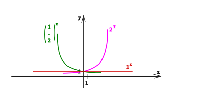

---

[Vissza](../matematika.md)

---

# Exponenciális és logaritmikus egyenletek

## Exponenciális függvény

### Feladat
$f_{(x)} = 2^{x}$
$$
\begin{array}{|l|l|l|l|l|l|l|}
\hline
x & 0 & 1 & 2 & 3 & -1 & -2 \\
\hline
2^{x} & 1 & 2 & 4 & 8 & 0.5 & 0.25 \\
\hline
\end{array}
$$

Az exponenciális függvény jellemzése:
1. 
    - értelmezési tartomány (Ét = x): $\forall \in \mathbb{R}$
    - értékkészlet (Ék = y): $y \in \mathbb{R}^{+}$ $(y>0)$
2. 
    - tengely metszet (Tm):
        - x: NINCS
        - y: y=1
3. 
    - Monotonitás: $\forall x \in \mathbb{R}$ - szigorúan monoton nő
4. 
    - Szélsőérték (Szé):
        - MIN: NINCS
        - MAX: NINCS
5. 
    - Párosság:
        - NINCS
    
### Monotonitás
- Szigorúan monoton nő, ha az egyik alapja nagyobb 1-nél
- Szigorúan monoton csökken, ha az exponenciális függvény alakja 0-nál nagyobb, de 1-nél kisebb

Az exponenciális függvény alapja nem lehet negatív ($2^{-x}$ ahol $2$ az alap és $^{-x}$ a kitevő)

### Feladat
$$
\begin{array}{|l|l|l|l|l|l|}
\hline
x & 3 & 2 & 1 & 0 & -1 & -2 \\
\hline
(\frac{1}{2})^{x} & 1 & \frac{1}{8} = 0.125 & \frac{1}{4} = 0.25 & \frac{1}{2} = 0.5 & 1 & 2 & 4 \\
\hline
\end{array}
$$

## Hatványozás szabályai
- Azonos alapú hatványok szorzása: $a^{m} \cdot a^{n} = a^{m+n}$
- Azonos alapú hatványok osztása: $\frac{a^{m}}{a^{n}} = a^{m-n}$ (Ha $a \neq 0 $)$
- Hatvány hatványa: $(a^{m})^{n} = a^{m \cdot n}$
- Szorzat hatványa: $(a \cdot b)^{n} = a^{n} \cdot b^{n}$
- Tört hatványa: $(\frac{a}{b})^{n} = \frac{a^{n}}{b^{n}}$ (Ha $b \neq 0$)
- Negatív kitevő: $a^{-n} = \frac{1}{a^{n}}$ (Ha $a \neq 0$)
- Nulladik kitevő: $a^{0} = 1$ (Ha $a \neq 0$) $\textit{Bármilyen nemnulla szám a nulladikon 1.}$

## Gyökszabályok
- Törtkitevős alak: $\sqrt[n]{a^{m}} = a^{\frac{m}{n}}$
- Gyök alatti szorzat: $\sqrt[n]{a \cdot b} = \sqrt[n]{a} \cdot \sqrt[n]{b} \textit{ Szétbontható külön gyökökre, vagy fordítva, összevonható.}$
- Gyök alatti hányados: $\sqrt[n]{\frac{a}{b}} = \frac{\sqrt[n]{a}}{\sqrt[n]{b}}$ Ha $b \neq 0$
- Gyök gyöke: $\sqrt[n]{\sqrt[m]{a}} = \sqrt[n \cdot m]{a} \textit{ A gyökindexeket összeszorozzuk; például: }\sqrt{\sqrt[n]{x}} = \sqrt[6]{x}$
- Gyökbővítés és egyszerűsítés: $\sqrt[n \cdot k]{a^{m \cdot k}} = \sqrt[n]{a^{m}}$

## Exponenciális egyenletek
$$
\begin{aligned}
2^{x} &= 4 \\
2^{x} &= 2^{2} \\
&\Downarrow \text{ Mivel az exponenciális függvény szigorúan monoton} \\
x &= 2 \\[2em]
3^{x} &= 9 \\
3^{x} &= 3^{2} \\
&\Downarrow \text{ Mivel az exp. fg. szig. mon.} \\
x &= 2 \\[2em]
2^{x+2} &= 16 \\
2^{x+2} &= 2^{4} \\
&\Downarrow \text{ mivel az exp. fg. szig. mon.} \\
x+2 &= 4 \quad /-2 \\
x &= 2 \\[2em]
3^{x+3} &= 81 \\
3^{x+3} &= 3^{4} \\
&\Downarrow \text{ mivel az exp. fg. szig. mon.} \\
x+3 &= 4 \quad /-3 \\
x &= 1 \\[2em]
5^{x+1} &= \frac{1}{125} \\
5^{x+1} &= \frac{1}{5^{3}} = 5^{-3} \\
&\Downarrow \text{ mivel az exp. fg. szig. mon.} \\
x+1 &= -3 \quad /-1 \\
x &= -4 \\[2em]
7^{3+4} &= \frac{1}{49} \\
7^{x+4} &= 7^{-2} \\
&\Downarrow \text{ mivel az exp. fg. szig. mon.} \\
x+4 &= -2 \quad /-4 \\
x &= -6 \\[2em]
8^{x} &= 4^{3} \\
(2^{3})^{x} &= (2^{2})^{3} \\
2^{3x} &= 2^{6} \\
&\Downarrow \text{ mivel az exp. fg. szig. mon.} \\
3x &= 6 /:3 \\
x &= 2 \\[2em]
8^{2x-3} &= 4 \\
(2^{3})^{2x-3} &= 2^{2} \\
2^{6x-9} &= 2^{2} \\
&\Downarrow \text{ mivel az exp. fg. szig. mon.} \\
6x-9 &= 2 \quad /+9 \\
6x &= 11 \quad /:6 \\
x &= \frac{11}{6} \\[2em]
\sqrt[3]{5^{x}} &= 125 \\
(5^{x})^{\frac{1}{3}} &= 5^{3} \\
5^{\frac{x}{3}} &= 5^{3} \\
&\Downarrow \text{ mivel az exp. fg. szig. mon.} \\
\frac{x}{3} &= 3 \quad /\cdot3 \\
x &= 9 \\[2em]
27\cdot \sqrt[5]{3^{x}} &= \frac{1}{9} \\
27 \cdot 3^{\frac{x}{5}} &= \frac{1}{9} \\
27 \cdot 3^{\frac{x}{5}} &= 3^{-2} \\
3^{3} \cdot 3^{\frac{x}{5}} &= 3^{-2} \\
&\Downarrow \text{ mivel az exp. fg. szig. mon.} \\
3+\frac{x}{5} &= -2 \quad /-3 \\
\frac{x}{5} &= -5 \quad /\cdot5 \\
x &= -25 \\[2em]
\text{Házi feladat:} \\
9^{x-1} &= 81 \cdot \sqrt{3} \\
(3^{2})^{x-1} &= 3^{4} \cdot 3^{\frac{1}{2}} \\
3^{2x-2} &= 3^{4+\frac{1}{2}} \\
3^{2x-2} &= 3^{\frac{9}{2}} \\
&\Downarrow \text{ mivel az exp. fg. szig. mon.} \\
2x-2 &= \frac{9}{2} \quad /+2 \\
2x &= \frac{13}{2} \quad /:2 \\
x &= \frac{13}{4}
\end{aligned}
$$

---

[Vissza](../matematika.md)

---
