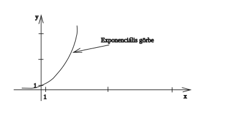

---

[Vissza](../matematika.md)

---

# Exponenciális és logaritmikus egyenletek

## Exponenciális függvény

### Feladat
$f_{(x)} = 2^{x}$
$$
\begin{array}{|l|l|l|l|l|l|l|}
\hline
x & 0 & 1 & 2 & 3 & -1 & -2 \\
\hline
2^{x} & 1 & 2 & 4 & 8 & 0.5 & 0.25 \\
\hline
\end{array}
$$

Az exponenciális függvény jellemzése:
1. 
    - értelmezési tartomány (Ét = x): $\forall \in \mathbb{R}$
    - értékkészlet (Ék = y): $y \in \mathbb{R}^{+}$ $(y>0)$
2. 
    - tengely metszet (Tm):
        - x: NINCS
        - y: y=1
3. 
    - Monotonitás: $\forall x \in \mathbb{R}$ - szigorúan monoton nő
4. 
    - Szélsőérték (Szé):
        - MIN: NINCS
        - MAX: NINCS
5. 
    - Párosság:
        - NINCS
    
### Monotonitás
- Szigorúan monoton nő, ha az egyik alapja nagyobb 1-nél
- Szigorúan monoton csökken, ha az exponenciális függvény alakja 0-nál nagyobb, de 1-nél kisebb

Az exponenciális függvény alapja nem lehet negatív ($2^{-x}$ ahol $2$ az alap és $^{-x}$ a kitevő)

### Feladat
$$
\begin{array}{|l|l|l|l|l|l|}
\hline
x & 3 & 2 & 1 & 0 & -1 & -2 \\
\hline
(\frac{1}{2})^{x} & 1 & \frac{1}{8} = 0.125 & \frac{1}{4} = 0.25 & \frac{1}{2} = 0.5 & 1 & 2 & 4 \\
\hline
\end{array}
$$

## Exponenciális egyenletek
$$
\begin{aligned}
2^{x} &= 4 \\
2^{x} &= 2^{2} \\
&\Downarrow \text{ Mivel az exponenciális függvény szigorúan monoton} \\
x &= 2 \\[2em]
3^{x} &= 9 \\
3^{x} &= 3^{2} \\
&\Downarrow \text{ Mivel az exp. fg. szig. mon.} \\
x &= 2 \\[2em]
2^{x+2} &= 16 \\
2^{x+2} &= 2^{4} \\
&\Downarrow \text{ mivel az exp. fg. szig. mon.} \\
x+2 &= 4 \quad /-2 \\
x &= 2 \\[2em]
3^{x+3} &= 81 \\
3^{x+3} &= 3^{4} \\
&\Downarrow \text{ mivel az exp. fg. szig. mon.} \\
x+3 &= 4 \quad /-3 \\
x &= 1 \\[2em]
5^{x+1} &= \frac{1}{125} \\
5^{x+1} &= \frac{1}{5^{3}} = 5^{-3} \\
&\Downarrow \text{ mivel az exp. fg. szig. mon.} \\
x+1 &= -3 \quad /-1 \\
x &= -4 \\[2em]
7^{3+4} &= \frac{1}{49} \\
7^{x+4} &= 7^{-2} \\
&\Downarrow \text{ mivel az exp. fg. szig. mon.} \\
x+4 &= -2 \quad /-4 \\
x &= -6 \\[2em]
8^{x} &= 4^{3} \\
(2^{3})^{x} &= (2^{2})^{3} \\
2^{3x} &= 2^{6} \\
&\Downarrow \text{ mivel az exp. fg. szig. mon.} \\
3x &= 6 /:3 \\
x &= 2 \\[2em]
8^{2x-3} &= 4 \\
(2^{3})^{2x-3} &= 2^{2} \\
2^{6x-9} &= 2^{2} \\
&\Downarrow \text{ mivel az exp. fg. szig. mon.} \\
6x-9 &= 2 \quad /+9 \\
6x &= 11 \quad /:6 \\
x &= \frac{11}{6} \\[2em]
\end{aligned}
$$

---

[Vissza](../matematika.md)

---
